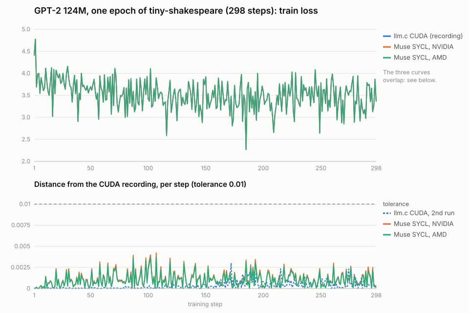

# K1: GPT-2 trains for a full epoch on NVIDIA and AMD, matching llm.c's CUDA curve

Every earlier training check ran 10 steps. Here GPT-2 124M trains for **one full epoch of
tiny-shakespeare: 298 steps** at B=4, T=256 (`-b 4 -t 256 -l 0.0001 -v 25 -m 10`). Two programs
run it:

- **llm.c's own CUDA trainer**, `train_gpt2_fp32.cu`, built with `nvcc`;
- **Muse's SYCL trainer** from J3 ([`../j3-trainer/run1/port`](../j3-trainer/run1/port)),
  unchanged, with oneMath on cuBLAS or rocBLAS.

## How it was checked

1. **Record the reference.** llm.c's CUDA trainer ran twice on an RTX 2000 Ada (the toolkit's
   `record_native`), and the first run became the reference curve: 13 val losses and 298 train
   losses, 311 values.
   - The two runs are not bit-identical. Their worst difference, **0.0030**, is the noise floor
     of llm.c's own CUDA.
   - The check's tolerance stays at llm.c's own 1e-2.
2. **Run the SYCL trainer against it** on an NVIDIA GPU and on an AMD MI350X. On NVIDIA,
   llm.c's CUDA trainer also ran again on the same GPU, so the two programs could be compared
   directly.

The wrapper ([`museport/curves.py`](../../src/museport/curves.py), `RUN_CURVE`) prints every loss
and each step's time as one JSON line. The toolkit keeps that output in each run's results, and
[`curves.json`](curves.json) collects them. A test recomputes the numbers below, and the chart,
from those results.

## Results

| Run | GPU | Worst difference from the CUDA recording (311 values) | Check (atol 1e-2) |
|---|---|---|---|
| llm.c CUDA, second run | RTX 2000 Ada | 0.0030 | (the noise floor) |
| llm.c CUDA | RTX A5000 | 0.0014 | PASS |
| **Muse SYCL** | **RTX A5000** | **0.0042** | **PASS** |
| **Muse SYCL** | **AMD Instinct MI350X** | **0.0037** | **PASS** |

- **Muse's SYCL vs llm.c's CUDA, on the same A5000, live:** PASS, worst 0.0040.
- **Both SYCL runs stay within about 1.4 times llm.c's own run-to-run noise** for all 298
  steps. The difference does not grow over the epoch (lower panel): the mean difference over
  each third of the epoch is 0.0010, 0.0012 and 0.0010 on NVIDIA, and 0.0009, 0.0011 and 0.0009
  on AMD.
- **The loss falls as llm.c's does:** val loss from 4.81 to 3.64, the same in all four runs to
  within the differences above.

**Time per step** (median of the program's own timer, one run each; rough):

| GPU | llm.c CUDA | Muse SYCL |
|---|---|---|
| RTX A5000 | 54 ms | 78 ms |

- **On the same GPU, Muse's port is about 1.4× slower** than llm.c's fp32 CUDA trainer. That
  trainer is itself llm.c's simple reference path, not its fast bf16 one.
- **Other GPUs:** the RTX 2000 Ada (CUDA, 110 ms) and the MI350X (SYCL, 27 ms) are different
  GPUs, so their times are not a speed comparison.

## Runs and cost

| Step | Machine | Result | Cost |
|---|---|---|---|
| Record llm.c's CUDA ([summary](record/nvidia-rtx-2000-ada-generation/llmc_gpt2_curve_record/SUMMARY.md)) | Runpod RTX 2000 Ada | recorded, two runs within 0.0030 | $0.009 |
| SYCL on NVIDIA ([summary](nvidia/nvidia-rtx-a5000/llmc_gpt2_curve_sycl_nvidia/SUMMARY.md)) | Runpod RTX A5000 | PASS vs recording and vs llm.c's CUDA | $0.013 |
| SYCL on AMD ([summary](amd/amd-instinct-mi350x-vf-gfx950-sramecc-xnack-hip-71460-85/llmc_gpt2_curve_sycl_amd/SUMMARY.md)) | DigitalOcean MI350X | PASS vs recording | $0.147 |

**Total $0.17 of GPU time, no Muse cost.** All machines were confirmed deleted ([`logs/`](logs)).

- **Toolkit change:** these runs used the toolkit's `benchmark_runs` task field
  ([#29](https://github.com/checocadena/oneapi-agent-toolkit/pull/29)), set to 0, so `gpu-test` did
  not repeat each training run 10 times for timing.
- **Limits:**
  - one epoch of a small dataset, one run per GPU;
  - fp32 only;
  - the speed figure is one rough measurement on one GPU.
